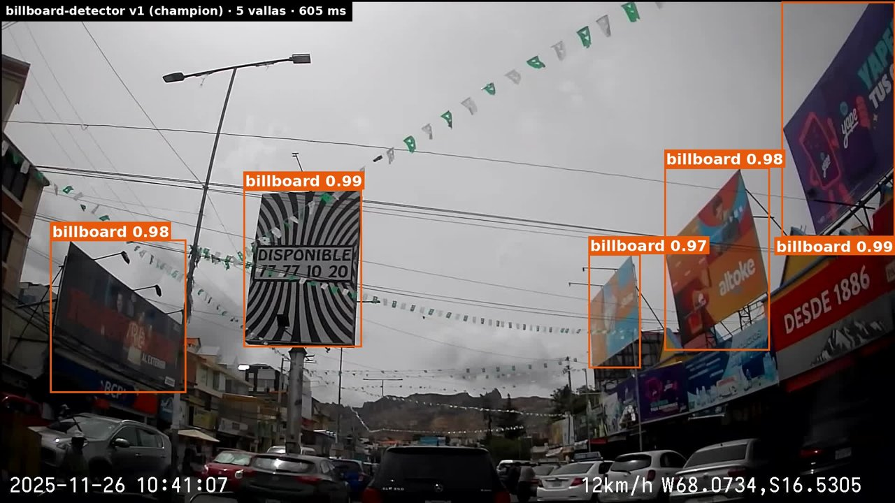
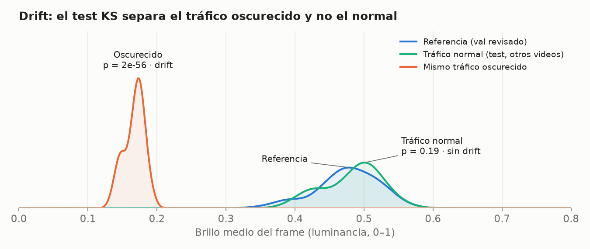
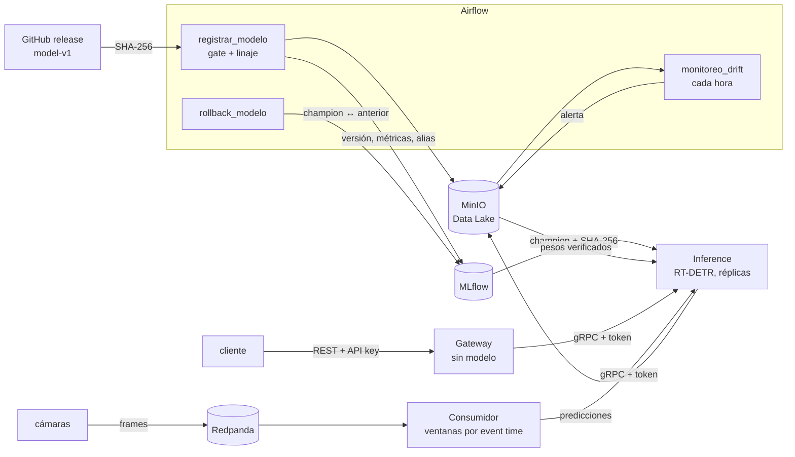

# billboard-detector-mlops

[](https://github.com/ChristianConchari/billboard-detector-mlops/actions/workflows/ci.yml)

Este proyecto pone en producción un **sistema de detección de vallas publicitarias** en imágenes de cámaras de calle.
TP integrador de *Operaciones de Aprendizaje Automático II* (CEIA · FIUBA). Autor: Christian Conchari.

**Caso de uso.** El servicio está pensado como el microservicio de detección de una **plataforma de
etiquetado geolocalizado de imágenes**: vehículos de relevamiento recorren la ciudad con una cámara, cada frame llega
con su posición GPS, y el servicio devuelve dónde hay vallas para que la plataforma las etiquete en el mapa. Este
repositorio implementa y demuestra ese servicio de forma autónoma; la integración con la plataforma queda fuera de su alcance.

El modelo ya está entrenado: es el RT-DETR del proyecto
[vit-billboard-detector](https://github.com/ChristianConchari/vit-billboard-detector) (release
[`model-v1`](https://github.com/ChristianConchari/vit-billboard-detector/releases/tag/model-v1),
mAP 0.649 en test). Este repositorio resuelve lo que viene después de entrenar, con tres preguntas
como guía:

1. **¿Cómo se evita que un modelo peor llegue a producción?** Un DAG lo evalúa sobre datos que no vio,
   lo compara con el modelo actual sobre los mismos datos y deja registrado qué datos y qué código
   produjeron cada métrica.
2. **¿Cómo se sirve sin que se caiga ni se abuse?** Un gateway autenticado y sin modelo valida y
   reenvía por gRPC a un servicio de inferencia escalable, que verifica los pesos antes de servirlos.
   Las cámaras publican en un broker que absorbe la diferencia entre lo que producen y lo que el modelo procesa.
3. **¿Cómo se sabe que dejó de funcionar sin tener etiquetas?** Un monitoreo horario compara las
   predicciones contra una referencia y alerta cuando cambian.



## Resultados

Medido en una instalación limpia, en CPU (i7-12700F), sin GPU.

| Qué | Resultado |
|---|---|
| Gate de promoción (95 imágenes de 7 videos no vistos) | **mAP 0.647**, IC 95 % 0.611–0.705 · AP50 0.930 (el release: 0.649 / 0.930) |
| Registro de punta a punta (`registrar_modelo`) | 3,7 min, sin pasos manuales |
| Latencia por imagen | p50 ~290 ms (8 hilos) a ~440 ms (4 hilos) |
| Throughput | 3,3 req/s con una réplica de 8 hilos · 4,0 req/s con dos de 4 hilos |
| Imagen del gateway / RAM del servicio | 245 MB (vs 2,3 GB con el modelo) · 647 MiB (vs 1448 con dos copias del modelo) |
| Ataques de entrada | GIF disfrazado de JPEG → 415 · PNG de 20000×20000 → 422 sin decodificarla · sin API key → 401 · gRPC sin token → rechazado |
| Pesos alterados en el Data Lake | inference se niega a servirlos (el SHA-256 no coincide con MLflow) |
| Drift | tráfico normal de otros videos: sin alarma · el mismo tráfico de noche: alarma (p = 2e-56) |

- **El gate se mide sobre el `test`, no sobre el `val`.** Sobre el `val`, que se usó para calibrar el
  umbral, el modelo daba 0.817: una cifra optimista que no sirve para decidir. Con 95 imágenes el IC mide
  ±0,05, así que un candidato tiene que superar al champion por un margen mínimo sobre el mismo set.
- **Replicar sirve para throughput, no para latencia.** A igual CPU, dos réplicas dan ~20 % más
  requests por segundo con varios clientes; una réplica con más hilos responde más rápido a uno solo.
- **El drift se detecta sin etiquetas, pero no mide la calidad.** El test KS separa el tráfico
  oscurecido y no confunde videos nuevos con drift. Para medir si el modelo empeoró harían falta etiquetas.

  

Detalle, decisiones y limitaciones: [docs/arquitectura.md](docs/arquitectura.md).

## Cómo funciona



1. **Registro.** `registrar_modelo` baja los pesos del release (verifica el SHA-256 del zip), los guarda
   en MinIO como una versión inmutable y mide mAP, AP50 e IC sobre el `test` revisado. Cada evaluación
   queda en MLflow con el set de evaluación, su hash, el hash del código y el commit. Si supera el
   mínimo y le gana al champion (re-evaluado sobre el mismo set), pasa a `champion`; el anterior queda
   como `anterior` para el rollback.
2. **Serving.** El gateway REST es el único servicio expuesto: autentica con API key, limita la tasa
   y el tamaño, y reenvía la imagen por gRPC. `inference` es el único que tiene el modelo: valida el
   formato real y las dimensiones antes de decodificar, carga solo pesos cuyo hash coincide con el
   registrado y guarda cada predicción (sin la imagen).
3. **Streaming.** Las cámaras publican frames en Redpanda con la cámara como clave: todos los frames
   de una cámara caen en la misma partición y conservan su orden. El consumidor los infiere y arma ventanas de 15 s por el instante de captura, con
   tolerancia a frames desordenados, y alerta si la latencia supera el SLO.
4. **Monitoreo.** `monitoreo_drift` compara cada hora las predicciones (REST y streaming) contra la
   referencia: chi² para la cantidad de vallas por frame, KS para score, brillo y contraste, con
   corrección de Holm. Si hay drift, deja una alerta y la corrida falla.

La regla de diseño fue que **cada pieza tenga un consumidor o una razón operativa**. GraphQL, los RPCs
de streaming, guardar imágenes para reetiquetar, Label Studio y el aprendizaje federado se evaluaron y
quedaron afuera ([por qué](docs/arquitectura.md#qué-se-dejó-afuera-y-por-qué)).

## Cómo empezar

Requisitos: Docker con Compose v2, Python 3, ~8 GB de RAM libres, ~13 GB de disco y el zip del dataset
`billboards-2025-09-14-sur-lp` (privado, no se versiona).

```bash
git clone https://github.com/ChristianConchari/billboard-detector-mlops.git && cd billboard-detector-mlops

# 1. Dataset: queda como data/billboards-2025-09-14-sur-lp/{annotations,images,manifest.json}
mkdir -p data && unzip <ruta>/billboards-2025-09-14-sur-lp-*.zip -d data

# 2. .env con secretos aleatorios y AIRFLOW_UID = tu UID (no se versiona)
scripts/generar_env.sh

# 3. Levantar todo (~10 min la primera vez, por torch)
docker compose --profile all up -d --build

# 4. Registrar el modelo (~4 min): queda como champion si pasa el gate
docker exec airflow-apiserver airflow dags unpause registrar_modelo
docker exec airflow-apiserver airflow dags trigger registrar_modelo

# 5. Probar
set -a; . ./.env; set +a
curl -s localhost:8800/health    # {"status":"ok","model_loaded":true}
curl -H "X-API-Key: $GATEWAY_API_KEYS" -F image=@data/billboards-2025-09-14-sur-lp/images/<imagen>.jpg \
  localhost:8800/v1/detect
```

Hasta el paso 4, `inference` figura como `unhealthy` (su healthcheck exige el modelo cargado). Si el
build falla con `ReadTimeoutError` de PyPI, construir primero la imagen pesada
(`docker compose --profile all build inference`) y repetir el paso 3. Para apagar:
`docker compose --profile all down` (con `-v` borra también los volúmenes).

| Servicio | Dónde |
|---|---|
| Gateway REST | http://localhost:8800/docs (header `X-API-Key`) |
| Airflow | http://localhost:8080 (`airflow` / `_AIRFLOW_WWW_USER_PASSWORD` de `.env`) |
| MLflow | http://localhost:5001 (experimento `evaluaciones`: cada evaluación con su linaje) |
| MinIO | http://localhost:9001 (`minio` / `MINIO_SECRET_ACCESS_KEY`), bucket `data` |
| Redpanda | `localhost:19092`, topic `frames` |

Solo el gateway escucha fuera de la máquina; el resto está en `127.0.0.1`. Uso detallado (REST, gRPC,
streaming, DAGs, escalado, tests): [docs/uso.md](docs/uso.md). Demo: el notebook
[`notebooks/demo_deteccion_vallas.ipynb`](notebooks/demo_deteccion_vallas.ipynb) (inferencias, gRPC, seguridad, streaming y
drift con gráficos) más Airflow, MLflow y MinIO en el navegador ([guion](docs/demo.md)).

## Estructura del repositorio

```
airflow/dags/          registrar_modelo, rollback_modelo, monitoreo_drift
vallavision/           paquete compartido por los DAGs y los servicios:
                       detector, servicio de inferencia, gate, drift, ventanas, integridad
dockerfiles/           imágenes: gateway, inference, stream (consumidor), airflow, mlflow;
                       minio/init.sh crea un usuario por servicio con mínimo privilegio
proto/                 contrato gRPC
annotations/reviewed/  sets con cajas revisadas: gate (test) y referencia de drift (val)
notebooks/             demo de la presentación (notebook + demo_utils.py)
scripts/               generar_env, demo, ver_detecciones, camara_productor, benchmark
tests/                 72 tests sin el stack (corren en el CI)
docs/                  arquitectura, contrato, seguridad, uso, demo, estado
```

Base de la infraestructura: [facundolucianna/amq2-service-ml](https://github.com/facundolucianna/amq2-service-ml).

## Documentación

- [Arquitectura](docs/arquitectura.md): decisiones, resultados medidos, qué se dejó afuera y limitaciones.
- [Contrato](docs/contrato.md): REST, gRPC, streaming, layout del Data Lake y DAGs.
- [Seguridad](docs/seguridad.md): superficie expuesta y tabla de riesgos y controles (SAIF).
- [Uso](docs/uso.md): API, streaming, DAGs, escalado, tests y operación.
- [Sets revisados](annotations/reviewed/README.md): por qué se evalúa con estas anotaciones y no con las del export.
- [Estado y pendientes](docs/estado-y-pendientes.md): cómo retomar en otra máquina y trampas conocidas.
- [Alcance del Hito #1](docs/alcance.md): el diseño original y en qué cambió.
